# Grok Hackathon at the Museum, Pavia

[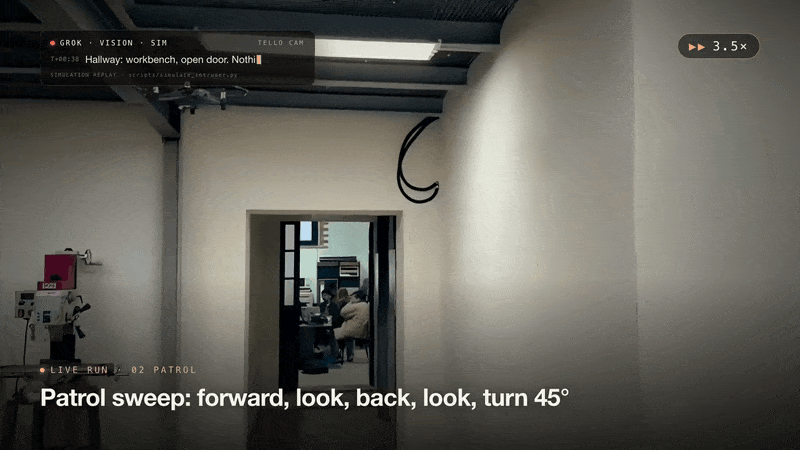](docs/media/mission-control-demo.mp4)

**One gallery. One dog. One drone. One model. One station that is allowed to move them.**

This is the team repository for the Grok Hackathon at Ctrl+Alt Museum, Pavia, 4–5 November 2026. Three trees sit side by side. They do not share a Python path.

| Folder | Who | What it owns |
| --- | --- | --- |
| [`dog backend/`](dog%20backend/README.md) | Dog | Unitree Go2 PRO: adapters, joystick, LiDAR, safety, and the dog tests. The dog checks obstacles and publishes safe steps. It does not take orders from a model file |
| [`ground base/`](ground%20base/README.md) | Ground | The mission computer. Tasks 01–32 are integrated here: validation, leases, halt, journal, Mission Control |
| [`person3-grok/`](person3-grok/README.md) | Vision | Grok vision, the presence trigger, and the Ground bridge. Set `PYTHONPATH` to that folder only. Point `PATROL_TEAM_REPO` at this repo root so the bridge can see `ground base` and `dog backend` without mixing `patrol` packages |

Pull requests on Ground run three checks: pytest, task simulations (32 tasks × seeds 0, 7, and 29), and composed demos (10 scenarios × Ethernet/Wi-Fi × the same three seeds).

Ground commands below run from [`ground base/`](ground%20base/).

---

# Ground

**The mission computer for a museum patrol.**

A Unitree Go2 and a Tello EDU share one room. One camera is in the air. One camera is on the dog. A Raspberry Pi on the dog hears the drone’s Wi-Fi. xAI Grok looks at the pictures. Somebody has to decide, in order, with a clock, what is allowed to move.

That somebody is Ground.

Ground is the station that sits between the operator, the robots, and the model. It validates every message, arms only the capabilities a peer actually reported, approves one bounded command at a time, tracks every acknowledgement, and writes a journal that can be replayed after the room is quiet. The model proposes. The dog and the drone enforce their own stops. Ground is the only process allowed to turn a proposal into a command.

Built for the **Grok Hackathon at the Museum, Pavia**: a closed gallery, a staged person, a tethered Go2, a scouting Tello, and an operator who can halt the whole loop without waiting for another inference.

```text
The drone finds the person.
The dog stays still while the drone is moving.
The Pi measures signal at the dog, and only at the dog.
Ground picks one step the dog planner already called safe.
When the dog camera sees the same person, the dog finishes on its own vision.
The goal and the landing are two different facts.
```

That station lives in [`ground base/`](ground%20base/). Tasks 01–32 are integrated there. The offline rehearsal runs the real policies over synthetic peers. It needs no robot SDK, no API key, and no network.

---

## Why this exists

A museum gallery is a bad place for an improvised robot stack.

The space is shared with people and with objects that do not move out of the way. The dog already has LiDAR, avoidance, and a planner. The drone already has its own flight watchdog. Grok already returns a box, a confidence, and a proposal. If those three talk to each other directly, a stale frame, a lost acknowledgement, or a confident caption can become a step that nobody approved.

Ground exists so that cannot happen.

| Pressure in the room | What Ground does about it |
| --- | --- |
| Two robots, one person, one operator | One session, one worker, one authority ticket |
| Vision is slow and sometimes wrong | One in-flight request, newest frame only, expiry before any reposition |
| Wi-Fi signal is not a map | RSSI stays a power reading at the Pi. Distance is a different measurement |
| The dog already knows which steps are safe | Ground chooses among candidate ids the dog published. It does not invent a path |
| A model must never drive a motor | Decisions and proposals stop at Ground. Commands are a separate, leased message |
| “We reached the person” is not “the aircraft is down” | Goal evidence and landing recovery are independent records |
| The cable is the link that works today | Ethernet is a chosen profile for the whole run. Wi-Fi is a different profile, selected before start |
| A demo has to be shown again tomorrow | Every run writes a journal. Ten failure stories are rehearsed on the same code as the happy path |

The older plan — a phone photo, a fixed dog route, a drone carried on the dog — is not this demo. This demo starts with the aircraft already in the air. The dog is dispatched only after a held beacon and a safe candidate. Landing is a recovery step with its own verification.

The full research, the equipment notes, and the message-by-message handoff live in [ground.md](ground%20base/ground.md). The wire shapes live in [contracts/README.md](ground%20base/contracts/README.md).

---

## What you get

A local mission computer with three ways to see the same truth.

1. **A Python station** (`python -m patrol.ground`) that loads all 22 drone-first providers, composes the ten base services, and runs one scenario to a report on disk.
2. **Ground Mission Control**, a Next.js console on `http://127.0.0.1:3000`, for arm, start, halt, recovery, vision, navigation, commands, journal, and replay.
3. **A verification gate** that runs the station the way a pull request runs it: pytest, 32 task simulations on three seeds, and 10 composed scenarios on Ethernet and Wi-Fi across the same three seeds.

Simulation is the product path you can run tonight. Live drone, live Grok, and live Pi stay refused until those transports and a physical acceptance exist. The Ethernet dog path is the one live motion this station will send, and only after an explicit arm and a reachable cable. Ground would rather exit than invent a robot that moved.

---

## The room, in one picture

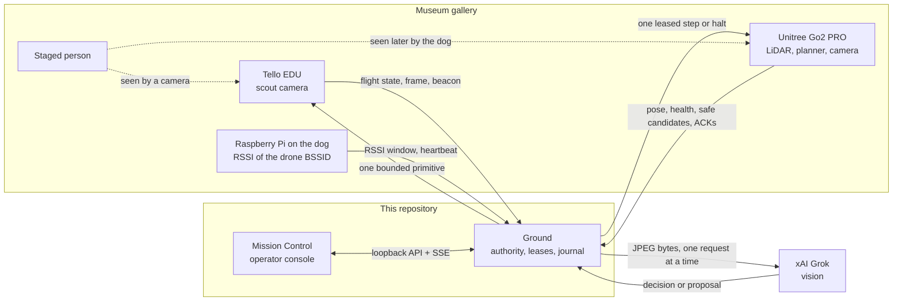

Nobody in that picture skips Ground.

- The drone does not send a caption to its own motors.
- The dog does not treat a Grok JSON file as a gait command.
- The Pi does not convert decibels into meters.
- The browser does not keep a second copy of the safety rules. Buttons follow the snapshot Ground already computed.

---

## The mission Ground runs

This is the drone-first demonstration. Each box is a policy in this repo. Each arrow is a checked message, not a hope.

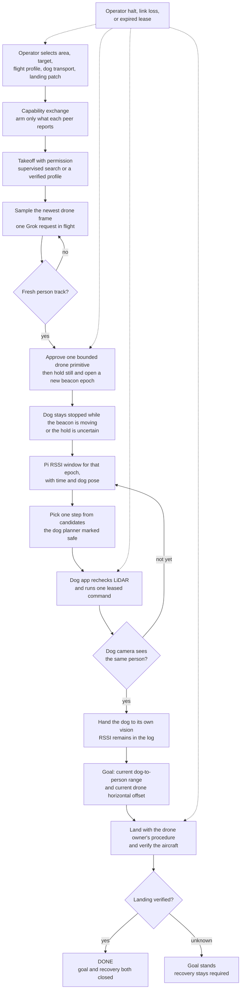

Halt does not wait for Grok. An obstacle stop does not wait for Grok. An expired lease does not wait for Grok. Those paths are in the station, in the same process as the happy path, and they are rehearsed as their own scenarios.

### What “arrived” means

Three numbers stay three numbers.

| Measurement | Who produces it | What it is allowed to mean |
| --- | --- | --- |
| Dog-to-person range | Dog camera track, fresh, same person | How close the dog is to the staged person |
| Drone horizontal offset | Drone pose against that same track | Where the aircraft sits in the horizontal plane |
| Obstacle clearance | Dog LiDAR / planner | Space around the body. A close obstacle is a different object |

At about four metres of altitude the aircraft cannot also be inside one metre of a standing person in full 3D. Ground records the two goal numbers separately. A missing range, a missing calibration, a broken track match, or a missing operator confirmation stays unresolved. The field stays null. Null is never written down as zero.

An accepted command means the peer took the message. A running acknowledgement means it is in progress. A completed acknowledgement means the peer reported a stop. An unknown landing is a fault that stays latched until new recovery evidence arrives. Reaching the person does not land the aircraft, and landing the aircraft does not rewrite the goal.

---

## How the code achieves it

The station is a small kernel, ten base services, and twenty-two drone-first policies. Policies are discovered from manifests. They are not hard-wired into a giant script. A missing provider fails the mission closed. It does not approve anything “for now.”

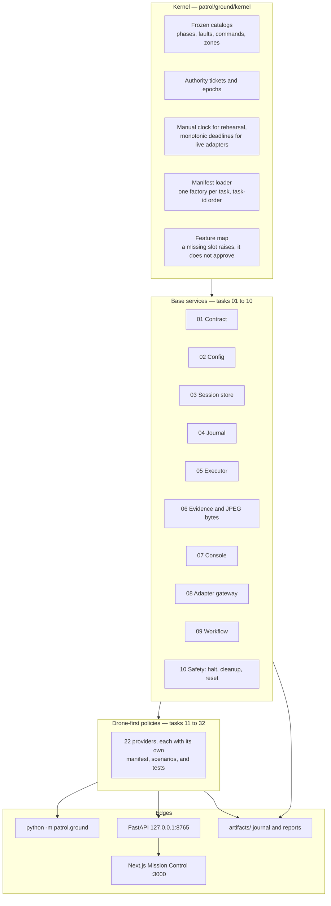

### The ten services every mission walks through

| Task | Service | What it guarantees |
| --- | --- | --- |
| 01 | Contract and kernel | The collaboration ABI, the slot table, the simulator, the quality gate. Later tasks register by manifest. They do not edit the kernel to announce themselves |
| 02 | Config | Frozen zone names. Dog, drone, and Grok are each `fake` or `real`. Secrets in operator JSON are rejected and never echoed |
| 03 | Session | One phase machine. Epochs advance on reset. An old confirmation dies with the old epoch |
| 04 | Journal | Append-only records with mission, state, ticket, clock, and redaction. A failed flush is an I/O fault that asks for recovery |
| 05 | Executor | Operations finish, fail, time out, or cancel. Retained asyncio work is collected against a deadline |
| 06 | Evidence | Real JPEG bytes, hash, dimensions, provenance, and artifact containment. Renaming a PNG to `.jpg` fails. `.jpg`, `.jpeg`, and uppercase extensions share one decoder and `image/jpeg` |
| 07 | Console | The operator surface the session is willing to show |
| 08 | Adapter gateway | The only door toward a device. Test doubles exist when a simulation builds them |
| 09 | Workflow | Phase commits the session store can legally walk. A stuck walk is a rejection, not a silent skip |
| 10 | Safety | Halt, cleanup, shutdown, reset. Priority over ordinary motion. Independent of the model |

Tasks 01–10 are the foundation. They do not implement the drone-first loop. Tasks 11–32 do, and they sit on top of those services rather than replacing them.

### The twenty-two policies, in the order the mission needs them

| Task | Slot | The job, in one line |
| --- | --- | --- |
| 11 | Envelope | Strict v2 envelopes, directions, and identity. Command ACKs share the issued id. Replays and old epochs die here |
| 12 | Capabilities | Admit what each peer reports. Arm that, and nothing invented: no fake controlled motion, no fake Pi link, no fake height |
| 13 | Drone observation | Ingest flight state and keep the height reference honest, including missing measurements |
| 14 | Frame | Camera epoch, frame provenance, and the actual image bytes |
| 15 | Vision schedule | One request in flight. Newest pending frame wins. Older frames are dropped. Clock error plus age is a budget |
| 16 | Vision decision | Correlate request, frame, track, camera, model, and prompt. Withhold motor authority. A decision is not a command |
| 17 | Drone command | One allowlisted primitive at a time. Safety is rechecked before any cache replay |
| 18 | Drone ACK | Accepted, running, and completed are different. Unknown landing queries the result. There is no automatic second takeoff |
| 19 | Beacon | A moving or expired beacon blocks the dog. A fresh hold opens a new epoch. Halt still wins |
| 20 | Dog navigation | Accept peer-reported safe candidate ids, with frame, map, expiry, and tether constraints. Ground does not run SLAM |
| 21 | RSSI | Validate the Pi window: BSSID, epoch, time, pose, quality. No signal is an empty list and a null median, never `0 dBm` |
| 22 | RSSI homing | Choose a step only inside comparable windows, with hysteresis and a no-progress stop |
| 23 | Dog command | A leased step needs current authority, a standing dog, avoidance, and the cable bound. Halt is the priority message |
| 24 | Dog ACK | Active or uncertain commands block the next step. A rejected step means the dog did not move |
| 25 | Dog acquire | Two fresh hits of the same track on the dog’s front camera hand the dog off RSSI. The wrong track goes to review |
| 26 | Proximity | The goal requires separate dog range and drone horizontal offset, fresh, from named sources |
| 27 | Recovery | Goal completion and aircraft recovery are independent. Unknown landing stays latched |
| 28 | Safety latch | Halt, link loss, and lease expiry fire without a model call. Pending work and the reset gate stay intact |
| 29 | Logs | Correlation-preserving redacted journal, written by the real task-04 disk writer |
| 30 | Links | Ethernet, Wi-Fi, and the Pi data path are checked before arming. There is no silent radio fallback and no OS route rewrite |
| 31 | Metrics | Timings come from the composed journal and one clock domain. Unknown values stay empty, with a reason |
| 32 | Rehearsal | The offline drone-first demo, on the real providers, with an operator script |

Ownership is narrow on purpose. Each task ships a manifest, an implementation, fixtures, and tests. The loader discovers them in task-id order. A factory path that shells out, climbs with `..`, or points outside its own directory is rejected.

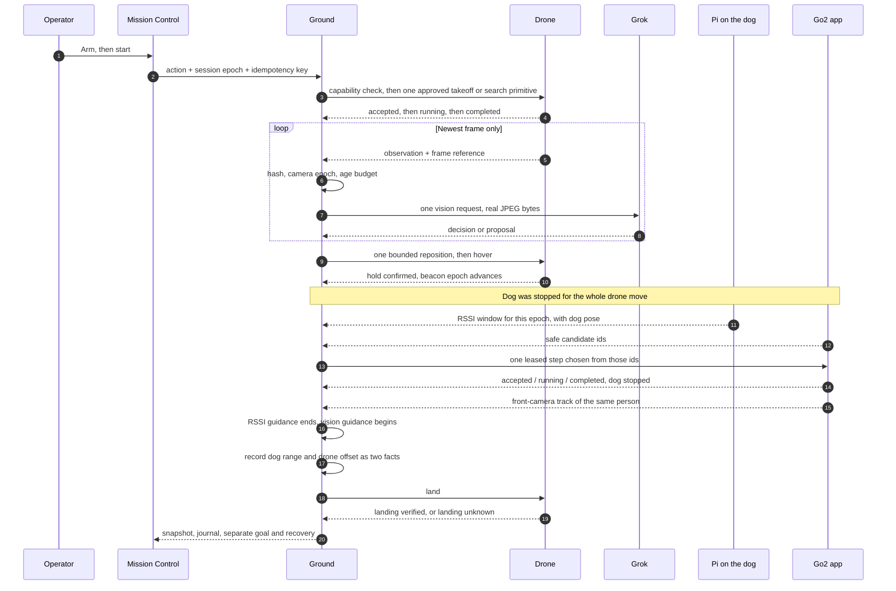

### A command is a life cycle, not a boolean

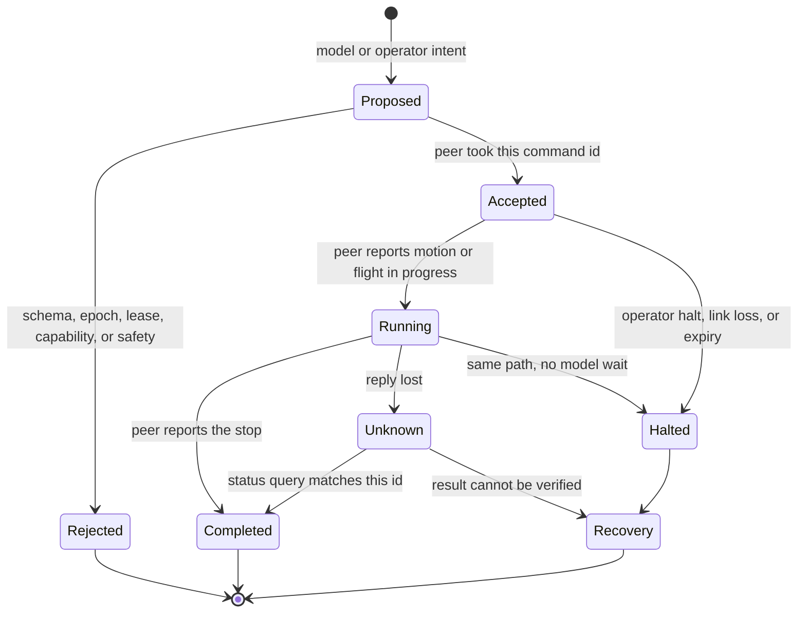

The same `command_id` with the same payload returns the known acknowledgement and does not execute again. The same id with a different payload is rejected. A timeout might mean the motion happened and the reply died, so Ground asks for the result. It does not invent a second takeoff to “be sure.”

### Session phases

The foundation session walks a frozen phase set. A workflow commit has to be a legal step. Reloading the page does not invent a new phase.

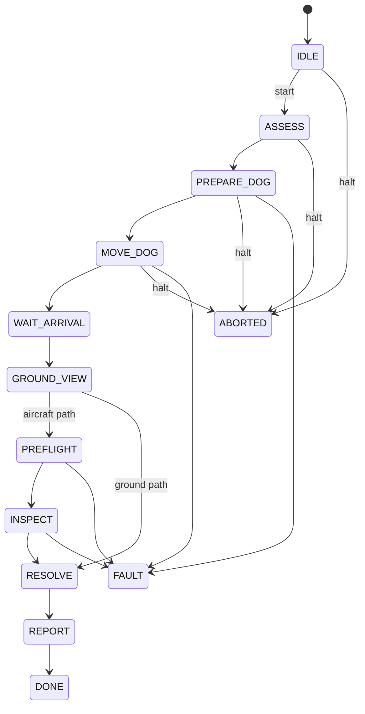

Any active phase may also fault or abort. Most of them can cut straight to `REPORT` when the mission should close without another move. `DONE`, `ABORTED`, and `FAULT` are terminals inside that session. Reset does not walk an edge backward. It opens a new disarmed `IDLE` session and leaves the old run on disk. An illegal edge is rejected and the snapshot stays where it was.

Museum zones the session already knows by name: `entrance`, `room_2`, `display`.

---

## Authority, drawn so it cannot be misunderstood

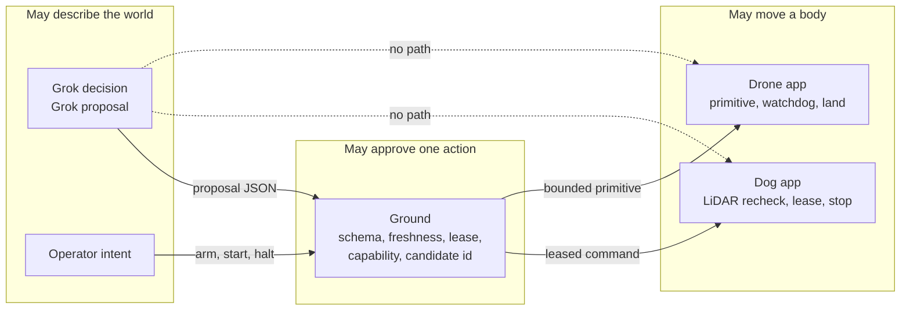

Image bytes travel as an artifact reference plus a hash. The vision request JSON does not contain the pixels. Ground resolves the artifact, checks the bytes, and only then is a model call allowed to see them. A path that exists on one laptop is not a picture on another machine.

Ordinary commands carry `expires_at`. The receiver enforces the remaining lease on arrival. A reconnect does not renew it. Halt and land stay available after ordinary work has expired, and they do not ask the model for permission.

---

## Mission Control

The browser is an operator console. Python remains the authority for mission state, device ownership, policy, leases, halt, recovery, and evidence.

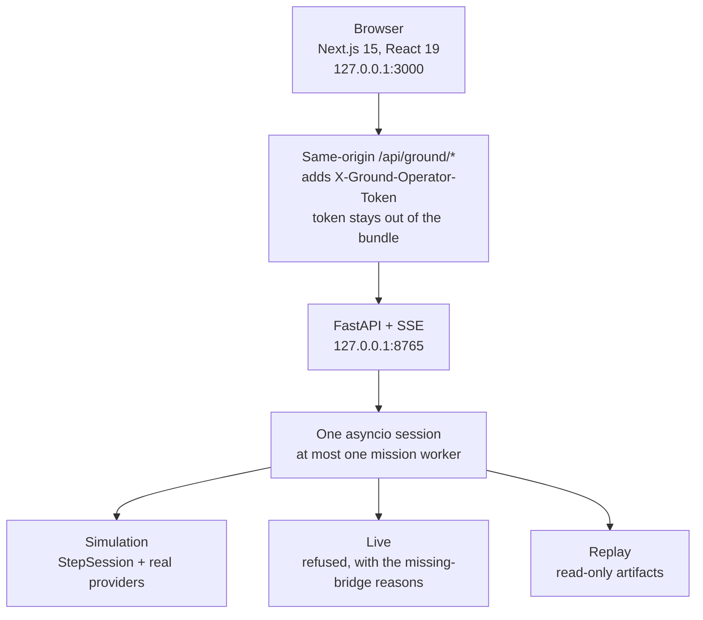

| You open | You see |
| --- | --- |
| Cockpit / Mission | Arm, start, supervised run, the one live Ethernet dog demo, halt in the header |
| Devices | Dog, drone, Pi, Grok modes. Live mode names what is missing. It does not substitute a fake device |
| Capabilities | What each peer reported, and only that |
| Vision | Frame, track, one in-flight request, decision versus proposal |
| Navigation | Safe candidates, RSSI windows, the step Ground actually selected |
| Commands / Leases | Issued id, acceptance, running, completion, expiry |
| Proximity | Dog range and drone offset as separate evidence |
| Recovery | Unknown landing latched beside a reached goal |
| Halt | Immediate. No confirmation dialog. Delivery to hardware stays unknown until a real transport says otherwise |
| Runs | History, detail, summary export |
| Evidence | Allowlisted JPEG by artifact id. Paths cannot escape the fixture store or the run root |
| Coverage | Tasks 01–32 |
| Rehearsal | Scenario choice, then the same API the cockpit uses |
| Settings | Ethernet or Wi-Fi, chosen before the run. Thresholds stay null until set |

Fencing is part of the console, not a footnote.

- Mutations other than halt, status, and quit require `session_epoch`.
- Halt bumps the epoch immediately.
- An `Idempotency-Key` returns the first result for that key.
- Two different keys cannot start two workers.
- A foreign `Origin` is rejected.
- The API binds to loopback.
- Reloading the page resynchronizes. It does not repeat an action.
- Server-sent events start with a snapshot. A cursor gap asks the browser to resync.

Start both processes:

```powershell
.\scripts\ground-mission-control.ps1
```

Then open `http://127.0.0.1:3000`. Closing the script stops both process trees. The operator guide is [docs/ground/operator-guide.md](ground%20base/docs/ground/operator-guide.md). The HTTP surface is [docs/ground/ui-architecture.md](ground%20base/docs/ground/ui-architecture.md). Step control from Python (`wait_more`, `retry`, `set_budgets`, `halt`) is [docs/ground/step-controls.md](ground%20base/docs/ground/step-controls.md).

---

## Failure is a first-class demo

The happy path is one scenario. The station ships the failures on the same providers, the same journal, and the same API. A failure returns exit code 1 and still writes the report. An existing run directory is never overwritten.

| Scenario | What the room did | What Ground keeps |
| --- | --- | --- |
| `happy_path` | Scout, home, acquire, goal, verified landing | Goal and recovery both closed |
| `unknown_landing` | The person was reached. The aircraft was not verified | Goal stands. Recovery stays required. No second takeoff |
| `blocked_planner` | The dog published no usable safe step | No invented detour |
| `noisy_rssi` | Windows that cannot be compared, or no progress | Homing stops. Signal is not laundered into metres |
| `stale_frame` | The picture is older than the age budget | No reposition from expired evidence |
| `uncontrolled_motion` | The aircraft is not holding a verified primitive | Dog stays stopped. Beacon epoch does not advance on a lie |
| `missing_pi_path` | The measurement radio has no path to the laptop | Arm refuses that feature |
| `halt` | The operator hits halt mid-loop | Accepted at once. Phase `ABORTED`. Model is not consulted |
| `link_loss` | The peer disappears | Leases die. Motion stops being issuable |
| `lease_expiry` | The command outlived its `expires_at` | The step is over. A reconnect does not renew it |

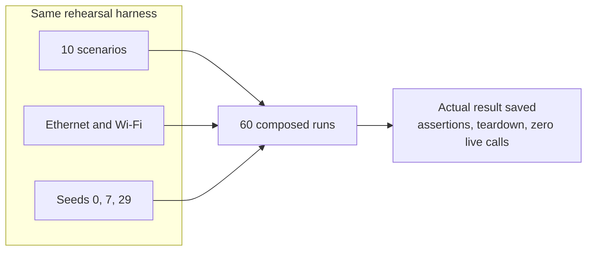

That is 10 × 2 × 3. Each run uses the real task 11–31 providers and the real base services. Device messages, link probes, images, and geometry are synthetic. The policies are not.

---

## Proof, already on disk

The latest recorded verification on this tree:

| Gate | Result |
| --- | --- |
| Tests | **1,494 passed**, 0 failed, 0 skipped |
| Task simulations | **96** runs — 32 tasks × seeds 0, 7, and 29 |
| Simulation cases executed | **1,347** |
| Simulation assertions | **24,156** |
| Composed demos | **60** — 10 scenarios × Ethernet/Wi-Fi × the same three seeds |
| Quality tasks | 32 / 32 |
| Live calls during simulation | **0** |
| Line coverage | **87.66%** |
| Branch coverage | **71.83%** |
| Nontrivial functions entered | **2,082 / 2,115** |
| Type check | `mypy` strict on `patrol.ground` |
| Lint | `ruff` on `patrol`, `tests`, and `tools` |
| Evidence label | `simulated` |
| Physical acceptance | Not performed. The station says so in the summary, on purpose |

Pull requests run that gate on Python 3.11 / Linux and Python 3.12 / Windows. See [.github/workflows/verify.yml](ground%20base/.github/workflows/verify.yml) and [docs/ground/verification.md](ground%20base/docs/ground/verification.md). Task-by-task scope is [docs/ground/verification/task-table.md](ground%20base/docs/ground/verification/task-table.md).

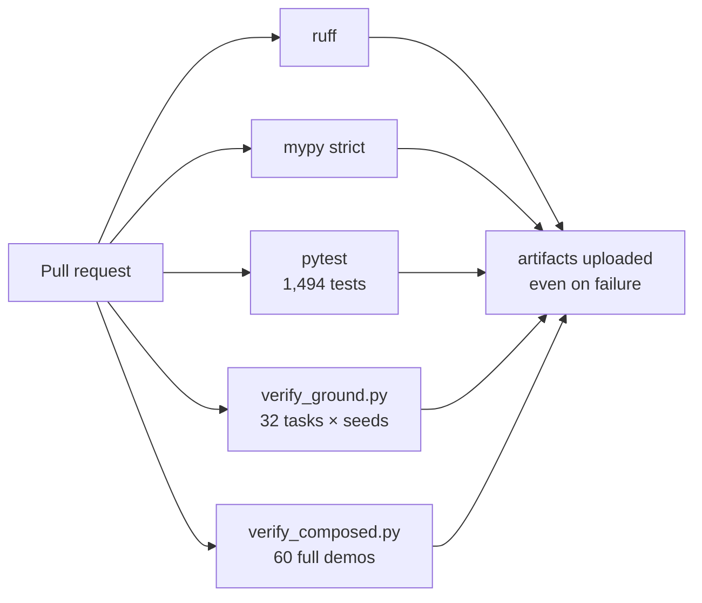

Twenty-four thousand assertions is the point. A renamed PNG, a duplicate final ACK, a stale beacon epoch, a null RSSI dressed up as zero, a command id that changed its payload, a goal inferred from obstacle clearance — each of those has a named case, on three seeds, and a teardown that checks the station did not keep going.

Reproduce it:

```powershell
python -m coverage run -m pytest -q
python -m coverage html -d artifacts/coverage-html
python -m ruff check patrol tests tools
python -m mypy patrol/ground
python tools/verify_ground.py
python tools/verify_composed.py
```

---

## Run the offline demo

Python 3.11 or newer. From `ground base`:

```powershell
python -m venv .venv
.\.venv\Scripts\python -m pip install -e ".[dev]"
.\.venv\Scripts\python -m patrol.ground --dog fake --drone fake --grok fake
```

That command loads all 22 v2 providers and composes the actual base services. Robot, Pi, link, geometry, and model inputs are synthetic. Reports and the real disk journal land under `artifacts/demo-*/`.

```powershell
python -m patrol.ground --dog fake --drone fake --grok fake --scenario unknown_landing
python -m patrol.ground --dog fake --drone fake --grok fake --dog-transport wifi --seed 29
```

`--help` lists every scenario. Failure scenarios exit 1 and keep an unresolved report. Passing `--dog real`, `--drone real`, `--grok real`, or `--pi real` exits 2 and names the refusal: teammate transports and physical acceptance are not in this tree, and the v1 `run_route` / `inspect` API is not a v2 RSSI or scouting transport.

### The one live dog motion

Ethernet to the Go2 is the cable demo. The laptop adapter is `192.168.123.222/24`. The dog listens on `192.168.123.161:8081`. Staff hold the controller. The phone app stays closed. Arm is explicit. If the cable is dark, the probe prints the reason and sends nothing.

```powershell
python -m patrol.ground --dog ethernet --drone fake --grok fake --arm
```

Add `--dog-sim` to drive the simulated body with no cable. Drone pictures and RSSI stay scripted on this path. A full live mode that would command the aircraft stays refused. Halt in that session also asks the dog for StopMove and a soft lie-down.

Wi-Fi for the dog is a separate profile you select before the run. There is no automatic handover. The four-metre flight profile stays disabled until a measured space and an approved profile exist. It is not the default.

### Operator console dependencies

```powershell
python -m venv .venv
.\.venv\Scripts\python -m pip install -e ".[dev]"
cd ui\mission-control
npm install
cd ..\..
.\scripts\ground-mission-control.ps1
```

Node.js 20 or newer. Fonts are bundled. After install, the simulated interface does not call the network.

Rehearse from the console: open Rehearsal, choose `happy_path`, arm, start. Arm does not move anything. One worker runs. A second start, another tab, or a reload does not create another mission. `DONE` means the simulation verified both the goal and the landing.

Reset after a fault asks for a recovery token, opens a new disarmed session, and leaves the old run in Runs. Reset without a token is available only when the goal and the landing are both verified and recovery is not required.

---

## Intruder simulation (Grok vision, offline)

A scripted run of the vision escalation: the drone sweeps, Grok flags a possible intruder, confirms it, and the dog is called. It uses the scripted `FakeReasoner` and the real presence helpers (`presence_state`, `suggested_action`, `image_direction`) from [`person3-grok/`](person3-grok/). It does not need a robot, an xAI key, or a network.

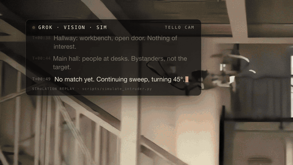

```bash
cd person3-grok
PYTHONPATH=. python scripts/simulate_intruder.py          # prints the run, writes artifacts/sim/intruder_run.jsonl
PYTHONPATH=. python -m pytest -q tests/test_simulate_intruder.py
```

Recorded output:

```text
T+  7.80s  info   Hallway: workbench, open door. Nothing of interest.
T+ 13.60s  info   Main hall: people at desks. Bystanders, not the target.
T+ 18.60s  info   No match yet. Continuing sweep, turning 45°.
T+ 25.40s  info   Person near the stairs, partly hidden. Holding.
T+ 28.00s  warn   [POSSIBLE] Seeing potential intruder. Investigating.
T+ 32.60s  alert  [CONFIRMED] Intruder confirmed. Calling dog.
T+ 35.80s  sys    [GROUND] Go2 dispatched to target. Lease granted.
T+ 41.80s  sys    [GO2] On scene. Confirming at ground level.
```

How each step is decided:

1. A frame with no person is logged as a scene note. The drone keeps sweeping.
2. The first person read comes back `uncertain`. `suggested_action` returns `review`, so the drone holds and investigates. Nothing is dispatched.
3. The next read of the same person comes back `person_visible`. `assess_incident` returns `dispatch`, and the dog is called.
4. On the dog's front camera `person_visible` maps to `approach`, and the dog confirms at ground level.

The dog is called only after a suspicion has been raised. The second test removes the uncertain read and checks that no dispatch happens. The timestamps match the live-run footage in the submission video, where the JSONL record is shown as the **GROK · VISION · SIM** panel. The panel is a replay of this simulation, not a live model transcript.

---

## The message contract

Protocol **2.0-draft**. Every message carries `protocol_version`, `message_id`, `mission_id`, `epoch`, `seq`, `sent_at`, `source`, `destination`, `kind`, `correlation_id`, `expires_at`, `simulated`, and `payload`.

- `message_id` is one immutable message. Retransmitting it does not authorize a second action.
- `command_id` is one action attempt across its whole ACK life.
- `seq` is monotonic per publisher per epoch.
- `correlation_id` ties a vision decision to its request and an ACK to its command.
- `frame_id`, `track_id`, `map_id`, `camera_epoch`, and `beacon_epoch` stop unrelated evidence from being mixed.
- Unknown fields are rejected.
- `simulated: true` on a message that claims to be live is rejected.
- Unknown quantities are `null` plus a validity or source field.

Examples, all synthetic, live in [contracts/examples/](ground%20base/contracts/examples/). Opening one does not fly or walk anything. The human handoff for each teammate:

| Teammate | Read first | They send Ground | Ground sends them |
| --- | --- | --- | --- |
| Drone | [contracts/drone-to-ai.md](ground%20base/contracts/drone-to-ai.md), [contracts/ai-to-drone.md](ground%20base/contracts/ai-to-drone.md) | Capabilities, observation, accepted / running / completed ACKs, landing-unknown | One move, hover, or land |
| Dog app | [contracts/dog-to-ai.md](ground%20base/contracts/dog-to-ai.md), [contracts/ai-to-dog.md](ground%20base/contracts/ai-to-dog.md) | Capabilities, pose and LiDAR, safe candidates, ACKs, rejections | One step, or halt |
| Vision | [contracts/vision.md](ground%20base/contracts/vision.md) | Decision or proposal for the exact request | A frame to classify. The proposal is not forwarded as a motor command |
| Pi | [contracts/rssi-and-navigation.md](ground%20base/contracts/rssi-and-navigation.md) | Capabilities, one RSSI window, heartbeat | Nothing that moves. Ground does not command the Pi |
| Everyone | [contracts/events-and-logs.md](ground%20base/contracts/events-and-logs.md) | — | Ground’s own journal: target acquired, dog dispatched, goal reached, landing unverified, proximity evidence |

A proposed WebSocket `/ws/robot/v2` is documented for teammates. This station does not pretend that socket is already the live transport. The operator API is the loopback HTTP surface above.

---

## Map of the tree

Ground’s code is the `ground base` folder.

```text
ground base/
├── patrol/
│   ├── contract.py                 v1 robot ABI, left intact
│   └── ground/
│       ├── __main__.py             CLI: fake rehearsal, or the armed Ethernet dog
│       ├── demo.py                 Composed drone-first rehearsal
│       ├── base.py                 The ten base services, wired once
│       ├── backend.py              In-process session for a frontend
│       ├── steps.py                Snapshot, budgets, wait, retry, halt
│       ├── dog_link.py             Ethernet dog link
│       ├── radio.py                Cable probe and the Pi 4 plan
│       ├── kernel/                 Catalogs, loader, clock, authority, faults
│       ├── operator/               FastAPI console, policy, snapshot, journal
│       └── extensions/
│           ├── g01 … g10           Foundation services
│           └── g11 … g32           Drone-first policies
├── tests/ground/                   Per-task suites plus integration
├── fixtures/ground/                Synthetic messages, images, allowlists
├── contracts/                      v2 shapes and examples
├── docs/ground/                    Operator guide, verification, UI, scope
├── ui/mission-control/             Next.js operator console
├── tools/                          verify_ground.py, verify_composed.py, scope audit
├── scripts/ground-mission-control.ps1
├── .github/workflows/verify.yml
├── ground.md                       Research, demo spec, who receives which JSON
└── pyproject.toml                  robot-patrol, Python >= 3.11
```

Runtime dependencies are deliberately small: Pillow, prompt_toolkit, FastAPI, uvicorn. Development adds pytest, mypy, ruff, coverage, jsonschema, and httpx. The UI is Next.js 15, React 19, and Tailwind, tested with Vitest.

| Document | When to open it |
| --- | --- |
| [ground.md](ground%20base/ground.md) | Why the demo is drone-first, the equipment, the sequence, the JSON each teammate receives |
| [ground task.md](ground%20base/ground%20task.md) | The assignable work, tasks 11–32 |
| [contracts/README.md](ground%20base/contracts/README.md) | Envelope rules and the communication graph |
| [docs/ground/operator-guide.md](ground%20base/docs/ground/operator-guide.md) | Install, rehearse, halt, recover, logs |
| [docs/ground/ui-architecture.md](ground%20base/docs/ground/ui-architecture.md) | What the browser owns and what it must not own |
| [docs/ground/step-controls.md](ground%20base/docs/ground/step-controls.md) | Backend step API and JSON examples |
| [docs/ground/verification.md](ground%20base/docs/ground/verification.md) | How the gates are counted |
| [docs/ground/scope-audit.md](ground%20base/docs/ground/scope-audit.md) | Task-by-task evidence and what physical acceptance still owes |
| [docs/ground/foundation.md](ground%20base/docs/ground/foundation.md) | How a new task is allowed to plug in |
| [demo/script.md](ground%20base/demo/script.md) | The operator brief for the handoff |

---

## Design rules the code actually enforces

These are not slogans in a slide. Each one has a rejecting test.

1. **Fail closed.** A missing provider, a missing capability, or a dark cable aborts or refuses. It does not approximate a success.
2. **One command in flight.** Drone primitives and dog steps are singular, leased, and keyed by id.
3. **Freshness is a budget.** Frames, beacons, RSSI windows, tracks, and commands all expire. Clock error counts against that budget.
4. **Epochs invalidate the past.** Reset, reconnect, and rearm move the epoch. Cached work from the old epoch cannot replay into motion.
5. **Candidates, not paths.** The dog publishes safe step ids. Ground selects. SLAM and avoidance stay in the dog app.
6. **RSSI is power at the Pi.** Stronger means closer to zero from below. Empty samples stay empty. Laptop RSSI is not a substitute. Every drone move invalidates the previous comparison.
7. **Bytes before belief.** Evidence is decoded JPEG, hashed, and contained. The model sees those bytes, or it sees nothing.
8. **Halt is local.** Link loss, lease expiry, and the header button do not queue behind inference.
9. **Goal and landing are different sentences.** The report can hold both, either, or neither, and it will say which.
10. **Null stays null.** Missing thresholds, missing ranges, and missing delivery of halt are null. They are not zero, and they are not “probably fine.”
11. **One worker.** A second tab is a spectator with a fresh snapshot, not a second mission.
12. **The journal is the memory.** Metrics are computed from records the composed run actually wrote. A number with no record does not appear.

---

## What this station is proud of

It is a complete ground segment for a two-robot vision demo, small enough to read and strict enough to trust on a stage.

- **Thirty-two tasks, one process.** Foundation and drone-first policy are integrated, discovered, and rehearsed together.
- **Twenty-four thousand assertions** across three seeds, with teardown and a live-call count of zero.
- **Sixty full demos** of the composed station, on both dog transports, including the failures a museum demo will actually hit.
- **A console that cannot outrun the station.** The browser renders Ground’s snapshot. It does not keep a private safety policy.
- **A model with no motor tools.** Grok is a brilliant observer on the side of the room. The lease, the candidate list, and the halt path are what move, or stop, the hardware.
- **An honest live gate.** Simulated success is labeled simulated. Real mode exits 2 until the bridges and the physical acceptance exist. The Ethernet dog demo is the one motion path, and it checks the cable before it sends a step.

Bring the cable, the staged person, and the operator. Ground already knows the order.

```powershell
.\scripts\ground-mission-control.ps1
```
