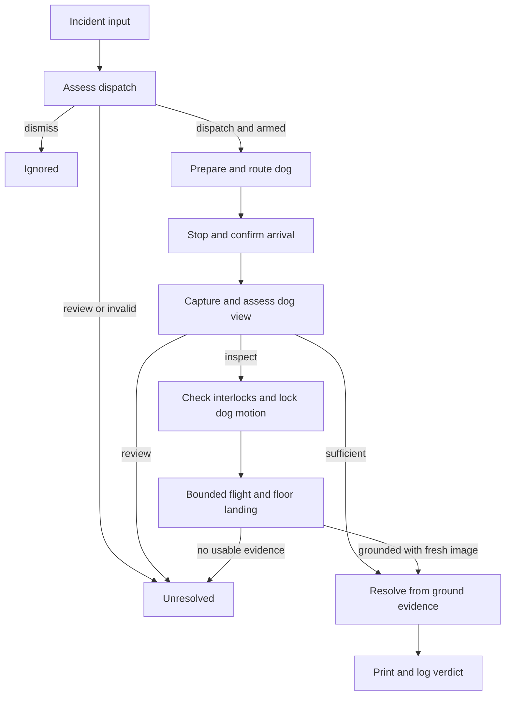

# Robot Patrol — implementation plan

Status: proposed build specification, contract version **1.0**. No robot or flight capability has been tested by writing this document. Read [tasks.md](tasks.md) for the four individual assignments.

This is a separate robotics project. It does not depend on the Resume Changer application in the parent directory. All implementation paths below are relative to a future Robot Patrol project root; they do not refer to the existing application's source folders.

## 1. What we are building

Build a supervised museum-security demonstration with a Unitree Go2 robot dog, a Tello EDU drone, a ground-station laptop, and Grok vision.

**A camera reports something worth checking. The dog goes to the marked area. If its view is blocked, Grok requests an elevated view. The stopped dog can deploy its carried drone. The drone takes a picture, lands on a cleared floor patch, and Grok uses the evidence to produce a short report.**

The dog supplies mobility. The drone supplies a temporary additional viewpoint. Grok recommends investigation and whether an additional view is useful. The ground station alone authorizes actions through bounded device adapters. Neither robot receives unrestricted language-model movement instructions.

The original notes describe several incompatible architectures. This build makes the following decisions:

| Question | Decision for this build |
| --- | --- |
| Does the drone scout before the dog moves? | No. A supplied phone/fixed-camera image starts the incident. |
| Does the dog follow the drone's Wi-Fi signal? | No. RSSI homing is outside this build. |
| How does the dog reach the incident? | A short, calibrated route from a known starting mark to a named zone. |
| Who requests the drone? | Grok can return `inspect`; the ground station checks all launch conditions. |
| What does the drone do? | One approved, bounded flight profile, using an elevated forward-camera image. |
| Does Grok fly it interactively? | No. Image reasoning happens after the drone has landed. |
| Where does it land? | A cleared floor patch away from the dog. A person retrieves it. |
| Is launch from the dog guaranteed? | No. It requires separate mount, carriage, release, takeoff, and abort tests. |
| What is the interface for the operator? | A local terminal with incident input, status, halt, arrival confirmation, and logs. |
| Does the demo send external messages? | No. The alert is printed and saved locally. External delivery is future work. |

This selects the **dog-first, carried-drone concept** from the supplied context. Drone-first patrol and RSSI navigation can become separate later experiments; they must not enter the four junior assignments.

## 2. What counts as a finished demonstration

There are two acceptance levels, which must be reported separately:

1. **Integrated software demo:** one command runs the complete incident workflow with explicit fake/real adapter selection; decisions, evidence, failures, and timing appear in a local log. It works without hardware or an API key in fake mode.
2. **Physical carried-drone demo:** the Go2 walks with the retained Tello, stops at a verified mark, the retention is safely released, the Tello launches from the stationary pad, captures an elevated image, and lands on the floor. A human-operated release is acceptable if shown and disclosed. An automatic release is not required.

A stationary-pad launch, where a person places the drone on the already-stopped dog, proves pad takeoff but **does not prove carriage**. A floor launch demonstrates aerial inspection but **does not complete the carried-drone claim**. Do not label these fallbacks as the full physical result.

The minimum useful recording shows:

1. The configured target and trusted zone on the screen.
2. A supplied camera image, followed by Grok's dispatch reason.
3. The dog following one short route and stopping at the mark.
4. The operator confirming arrival, and a fresh dog-camera image showing an obstructed view.
5. Grok requesting `inspect`, followed by the ground station's launch checks.
6. The selected physical launch tier, one short inspection, and floor landing.
7. Grok's evidence-based verdict and the local alert.
8. The log and measured event-to-arrival time. Classification results can be shown from the saved evaluation run.

The context mentions roughly 30 hours and a Thursday 16:00 presentation. These are planning assumptions, not a confirmed dated booking. Use elapsed-hour milestones below and confirm the actual equipment slots separately.

## 3. The exact incident workflow

### 3.1 Preparation

- Mark `start`, `entrance`, `room_2`, and `display` on the floor. Only implement real routes for the zones that can be calibrated safely; unsupported zones return `unsupported`.
- Every route begins from the same physically verified `start` position and orientation. There is no autonomous return-to-start in this version.
- Assign an initial phone image to a zone using operator input. The model does not infer which room the image came from.
- A person states the target. Default: `a person or an object left in a marked closed area`.
- Treat closed/open status as supplied scenario context. A single still image does not prove that an object is abandoned, that a person lacks permission, or that someone has malicious intent.
- Select adapters explicitly: `fake` or `real` independently for dog, drone, and reasoner. A mixed run must identify every simulated component.
- Before a real run, verify the start mark, route, dog status, drone status, carrier state, landing patch, network links, operator stop control, and current staff authorization for that slot. Keep the carrier secured during walking; release happens only after arrival and a separate flight-readiness check.

### 3.2 Dispatch

The ground station creates an `Incident`, records the monotonic start time, and calls `assess_incident()`.

| Decision | Meaning | Next action |
| --- | --- | --- |
| `dismiss` | Available evidence does not match the configured target. | Log `ignored`; no standing, walking, or flight commands. |
| `review` | The model cannot make a dependable dispatch decision. | Log `unresolved`; request operator review; no automatic dispatch. |
| `dispatch` | The scene warrants checking. | Prepare the dog and run the configured route. |

Connecting a device or reading status is not permission to move it. Real motion requires explicit arming for that incident.

### 3.3 Dog investigation

1. `prepare()` establishes a stable standing state and enables/read-backs the supported avoidance mode.
2. Ground checks that connected, standing, stationary, and avoidance-enabled are all explicitly `True` before starting the route. Unknown is not success.
3. `run_route(zone, ctx)` follows the dog owner's calibrated route and returns stopped. It does not search the building or accept coordinates from Grok.
4. A completed timed route means the command sequence finished. It does not independently establish physical arrival.
5. Ground waits for the operator's `arrived <zone>` confirmation at the floor mark. A failed/blocked route is not overridden by this confirmation; it requires recovery.
6. Ground records arrival time only after valid confirmation, then captures a fresh dog frame.
7. `assess_ground_view()` returns `sufficient`, `inspect`, or `review`.

`sufficient` means the ground image can support the final assessment; it does not mean the incident is clear. Ground calls `resolve_incident()` with the dog image and no aerial image. `review` ends as unresolved. `inspect` requests the bounded drone workflow below.

### 3.4 Additional viewpoint

Ground requires all of these before calling `inspect()`:

- The dog is connected, standing, and stationary, and the route is no longer running.
- A flight lock prevents every walking/turning command until landing and recovery are confirmed.
- The drone is connected and explicitly grounded; battery and flight checks pass the drone profile's calibrated limits.
- The zone has an approved inspection profile for the selected launch origin.
- After arrival, the real operator has issued `flight-ready` in `PREFLIGHT`, confirming the area, completed carrier release, launch orientation, and landing patch for this flight. Initial arming before walking cannot substitute for this confirmation.
- The selected launch tier has passed its physical tests. A configuration flag alone does not prove this.
- There is no halt request, expired deadline, or unresolved device state.

Pad launch with a real drone requires a real dog and physically verified stationary status. FakeDog telemetry must never authorize a real `dog_pad` launch. A real drone with a fake dog is permitted only as an explicitly supervised floor-flight test, with the same operator flight-readiness confirmation.

The flight adapter then performs one local sequence:

`take off → follow the approved clearance/viewpoint path → save a fresh frame → reach the approved floor landing position → land → verify grounded`

The dog remains stopped throughout. The flight path, altitude limits, orientation, and abort behavior belong to the drone package. Grok supplies none of those numbers. Start with one zone and one profile; three real flight profiles are not required for the first successful demo.

`inspect()` returns only after its landing attempt. A usable picture with unknown landing state is still a hardware-recovery condition. Ground must not resume dog movement or begin another incident.

After confirmed landing, Ground calls `resolve_incident()` with the ground and aerial frames. This prevents remote API latency from extending the flight. A person retrieves the drone; the next mission needs a fresh start-position check and explicit rearming.

### 3.5 Verdict and report

| Verdict | Interpretation | Terminal incident outcome |
| --- | --- | --- |
| `confirmed` | The supplied evidence supports the stated target. | `alerted` |
| `cleared` | Sufficient evidence supports clearing this particular staged incident. | `cleared` |
| `inconclusive` | Evidence is missing, obstructed, ambiguous, or contradictory. | `unresolved` |

`compose_alert()` writes a short report including zone, observation, verdict, and limitation if any. Ground prints and saves it. If this wording call fails after a valid verdict, Ground uses a deterministic template preserving that verdict. Missing evidence, API failure, or unavailable flight must never turn into `cleared`.

## 4. Hardware facts, uncertainties, and research starting points

These are source-backed starting points, not evidence that the available museum hardware works with our software.

### 4.1 Unitree Go2

The Go2 edition and firmware remain unknown. The official product table distinguishes capabilities by edition; do not assume an AIR/PRO exposes the same development services as an EDU. An app feature is not automatically a Python navigation API. See the [official Go2 specifications](https://www.unitree.com/go2/).

Use the community **`unitree_webrtc_connect`** integration as the first research path. The current upstream README documents Go2 variants, video and control support, connection modes, and device AES requirements for firmware 1.1.15 and later. The old pasted name `go2_webrtc_connect` must not be assumed to be the current import. Pin the tested release or commit after a successful installation. See the [upstream README](https://github.com/legion1581/unitree_webrtc_connect/blob/master/README.md).

Avoidance must be tested with the same movement path used by this project. Read its state back and inspect the upstream [avoidance example](https://github.com/legion1581/unitree_webrtc_connect/blob/master/examples/go2/data_channel/obstacles_avoid/obstacles_avoid.py). Enabling a service does not establish reliable obstacle prevention or route planning.

The official [SDK2 Python repository](https://github.com/unitreerobotics/unitree_sdk2_python) is a different DDS-based integration path. Do not mix its transport into the WebRTC implementation. If WebRTC cannot work on the actual unit, document the blocker and isolate a separately verified alternative behind the same adapter; other juniors keep working with fakes.

First dog session: identify model/firmware → connect without motion → read state and video → demonstrate halt → stand → enable/read back avoidance → one bounded supervised move → verify stopping and actual command-expiry behavior → calibrate one route.

Ask staff for the edition, firmware, permitted connection method, account/AES setup if needed, approved control mode, independent stop controller, payload mounting points, and available slot. Do not flash firmware or bypass access controls as a project task.

### 4.2 Tello EDU

The manufacturer [SDK 2.0 guide](https://dl-cdn.ryzerobotics.com/downloads/Tello/Tello%20SDK%202.0%20User%20Guide.pdf) specifies UDP command, state, and video ports 8889, 8890, and 11111. Relative translation commands accept 20–500 cm. `stop` hovers; `land` descends; `emergency` stops motors. These are different operations. It also documents automatic landing after 15 seconds without commands. Flight supervision must continue independently of model calls.

Use DJITelloPy inside the drone package, with video decoding through its tested dependencies. Its [upstream API documentation](https://djitellopy.readthedocs.io/en/latest/tello/) includes downward video selection on supported devices, but that command is absent from the manufacturer's SDK 2.0 list. Do not require downward video or dog recognition for this MVP. Use the forward camera from an elevated viewpoint. The same upstream documentation warns that EDU video streaming is unavailable when operating as a station on another Wi-Fi network; verify the AP topology instead.

The [manufacturer manual](https://terra-1-g.djicdn.com/2d4dce68897a46b19fc717f3576b7c6a/%E4%BA%A7%E5%93%81Info%20%E6%96%87%E4%BB%B6/Tello_User_Manual_V1.2_EN.pdf) describes a flat takeoff surface and positioning limits related to surface texture, lighting, and motion. It does not validate takeoff from a Go2's back. Pad dimensions, attachment, clearance from sensors and propellers, and launch height need measurement on the actual pair.

### 4.3 Carrier and launch tiers

The drone owner owns the carrier design and physical test record. The dog owner supplies only approved attachment constraints and payload/standing observations.

| Tier | Physical behavior | Required evidence |
| --- | --- | --- |
| `carried_pad` | Drone secured during walking; safely released after dog stops; launches from its back. | Retention test, short walking test, release check, stationary takeoff, floor landing, abort test. |
| `stationary_pad` | Drone placed by a person onto the already-stopped dog's pad. | Stationary takeoff, floor landing, abort test; explicitly no carriage claim. |
| `floor` | Drone placed at a marked floor launch point near the stopped dog. | Approved floor launch/viewpoint/landing profile. |
| unavailable | No safe real flight can be completed. | Dog-only unresolved report or clearly labeled replay. |

Strapping the drone itself down prevents takeoff. Leaving it unsecured while walking can let it fall. A flat plate is not a complete carrier. Use an approved carrier with a human release if that is the simplest tested solution. A person never reaches into active propellers.

Do not publish a guessed 20 × 20 cm mount as a build requirement. Measure the actual airframe, guards, Go2 mounting points, sensors, and clearance. Use prop guards and venue-approved parts. The dog must hold its tested stationary pose during release and launch.

The flight profile must clear the dog before descending. A raw `land()` command while above the dog descends toward the dog. Pad launch is disabled unless normal and abort paths have been demonstrated without autonomous landing back on the dog. Unknown aircraft position or a lost link requires the trained operator's recovery procedure; software cannot promise a safe landing after losing control.

### 4.4 Network topology

Use one ground-station laptop with simultaneous independent links:

```text
                         Internet / Grok
                               |
                    Ethernet or other uplink
                               |
Go2 <-- dedicated link A --> ground-station laptop <-- Wi-Fi adapter B --> Tello AP
```

Link A may be a supported local Go2 network connection. Link B joins the Tello access point. If the Go2 connection also supplies internet through a verified LAN setup, a separate third link is unnecessary. Otherwise provide one.

- The operating system must route the Tello subnet through its dedicated adapter and retain a working Go2 route and internet default route.
- The Tello default address is `192.168.10.1`; verify the actual route/interface during setup.
- The drone owner tests Tello control/video; the dog owner tests its device link; the coordinator owner records the combined setup.
- Do not switch one radio between networks during a run.
- Do not preserve the old blanket instruction that the laptop must never join the Tello AP. It needs that connection or an explicitly built relay to control and receive video.
- No phone RSSI scanner, mission-pad network, ROS, broker, or relay computer is required for this version.

### 4.5 Grok integration

Use the official `xai-sdk` asynchronous Python client inside the reasoning package. Image input and schema-constrained output are documented in the [image understanding guide](https://docs.x.ai/developers/model-capabilities/images/understanding), [structured-output guide](https://docs.x.ai/developers/model-capabilities/text/structured-outputs), and [official SDK](https://github.com/xai-org/xai-sdk-python).

Choose an image-capable model available to the actual account, verify it with one real image and structured response, and record its exact identifier in configuration and evaluation results. Do not scatter a model name through adapters. The model, SDK pin, prompt version, and schema version must be logged.

## 5. Fixed software choices and ownership

Use Python **3.11**, `asyncio`, standard-library dataclasses for the shared contract, JSON configuration, local JPEG files, JSON Lines logs, and `pytest` for behavior checks. Use Pydantic v2 internally in the Grok adapter for validating model responses. Hardware SDKs remain inside their device packages.

No web frontend, web server, database, ROS, Docker deployment, or cloud hosting is required. The operator's terminal is sufficient for this demonstration.

One Python process contains the coordinator and adapters. The coordinator calls adapters; adapters never import or call one another. Vendor blocking calls run in a serialized worker inside the relevant adapter, with bounded network timeouts. The event loop and halt input must remain responsive.

```text
patrol/
  contract.py                   frozen code from section 6
  dog/                          Junior 1: Go2 real + fake + selftest
  drone/                        Junior 2: Tello real + fake + selftest
  grok/                         Junior 3: reasoning real + fake + eval
  ground/                       Junior 4: coordinator, CLI, logs, private stubs
fixtures/
  dog/                          Junior 1 only
  drone/                        Junior 2 only
  grok/                         Junior 3 only
  ground/                       Junior 4 only
tests/{dog,drone,grok,ground}/    corresponding owner only
requirements/{dog,drone,grok,ground}.txt
config/{dog,drone,grok,ground}.example.json
handoff/{dog,drone,grok,ground}.md
eval/results.md                 Junior 3
demo/script.md                  Junior 4
artifacts/                      generated per-run output; not source fixtures
```

Junior 4 owns root packaging, package entry points, dependency aggregation, and the combined setup guide. Other juniors write only their module dependency file, pinning the versions they tested. All adapters must import and run in fake mode without their real hardware/API dependency installed. Import vendor packages lazily in real mode.

Python namespace packages allow a junior's private checkout to contain only `patrol/contract.py` and their own subpackage. Root `patrol/__init__.py` must have no eager adapter imports when added by Junior 4.

## 6. Frozen integration contract — version 1.0

This section is the shared interface. **It is available now; nobody waits for another junior to design it.** Each person may copy the following block unchanged into `patrol/contract.py` in their private branch. The senior retains one identical copy when merging. No junior owns the right to change this interface. Record proposed changes in the module handoff instead.

The dataclasses define the transport shape, not automatic runtime validation. Each adapter validates its inputs and outputs; Ground validates untrusted input, allowed values, frame metadata, and state transitions.

```python
from __future__ import annotations

from dataclasses import dataclass
from pathlib import Path
from threading import Event
from typing import Any, Literal, Mapping, Protocol

CONTRACT_VERSION = "1.0"
Zone = Literal["entrance", "room_2", "display"]
Mode = Literal["fake", "real"]
LaunchOrigin = Literal["dog_pad", "floor"]
FlightState = Literal["grounded", "airborne", "unknown"]
ErrorCode = Literal[
    "unsupported", "invalid_input", "not_connected", "timeout",
    "cancelled", "device_error", "api_error", "unsafe_state",
]

class AdapterError(RuntimeError):
    def __init__(self, code: ErrorCode, detail: str) -> None:
        self.code = code
        self.detail = detail
        super().__init__(f"{code}: {detail}")

@dataclass(frozen=True)
class RunContext:
    mission_id: str
    deadline_monotonic: float
    cancel: Event

@dataclass(frozen=True)
class Frame:
    path: str                    # absolute path to an existing JPEG
    source: Literal["phone", "dog", "drone"]
    zone: Zone                   # trusted caller metadata, not model output
    captured_at: str | None      # UTC ISO 8601; None only for unknown phone time
    simulated: bool

@dataclass(frozen=True)
class Incident:
    mission_id: str
    zone: Zone
    target: str
    initial_frame: Frame

@dataclass(frozen=True)
class DogStatus:
    connected: bool
    standing: bool | None
    stationary: bool | None
    avoidance_enabled: bool | None

@dataclass(frozen=True)
class RouteResult:
    completed: bool              # route execution, NOT verified arrival
    stopped: bool
    route_id: str
    detail: str

@dataclass(frozen=True)
class DroneStatus:
    connected: bool
    flight_state: FlightState
    battery_percent: int | None

@dataclass(frozen=True)
class InspectionRequest:
    zone: Zone
    profile_id: str              # allowlisted local profile, chosen by Ground
    launch_origin: LaunchOrigin

@dataclass(frozen=True)
class InspectionResult:
    outcome: Literal["captured", "unavailable", "failed", "cancelled"]
    frame: Frame | None
    flight_state: FlightState    # state AFTER landing attempt
    detail: str

@dataclass(frozen=True)
class DispatchDecision:
    action: Literal["dispatch", "dismiss", "review"]
    reason: str

@dataclass(frozen=True)
class GroundDecision:
    action: Literal["sufficient", "inspect", "review"]
    observation: str
    reason: str

@dataclass(frozen=True)
class Resolution:
    outcome: Literal["confirmed", "cleared", "inconclusive"]
    summary: str
    reason: str

class DogPort(Protocol):
    async def connect(self) -> DogStatus: ...
    async def prepare(self, ctx: RunContext) -> DogStatus: ...
    async def get_status(self) -> DogStatus: ...
    async def run_route(self, zone: Zone, ctx: RunContext) -> RouteResult: ...
    async def capture_frame(self, zone: Zone, ctx: RunContext) -> Frame: ...
    async def halt(self) -> None: ...
    async def close(self) -> None: ...

class DronePort(Protocol):
    async def connect(self) -> DroneStatus: ...
    async def get_status(self) -> DroneStatus: ...
    async def inspect(self, request: InspectionRequest,
                      ctx: RunContext) -> InspectionResult: ...
    async def land(self) -> None: ...
    async def close(self) -> None: ...

class ReasonerPort(Protocol):
    def metadata(self) -> Mapping[str, str]: ...
    async def assess_incident(self, incident: Incident,
                              ctx: RunContext) -> DispatchDecision: ...
    async def assess_ground_view(self, incident: Incident, frame: Frame,
                                 ctx: RunContext) -> GroundDecision: ...
    async def resolve_incident(self, incident: Incident, ground: Frame,
                               aerial: Frame | None,
                               ctx: RunContext) -> Resolution: ...
    async def compose_alert(self, incident: Incident, result: Resolution,
                            ctx: RunContext) -> str: ...
    async def close(self) -> None: ...
```

### 6.1 Exact imports and factories

Each subpackage exports its factory from `__init__.py`. Factories are ordinary synchronous functions that instantiate objects without connecting, moving hardware, or calling APIs:

```python
from patrol.dog import create_dog
from patrol.drone import create_drone
from patrol.grok import create_reasoner

# Identical keyword names on all three factories:
def create_dog(*, mode: Mode, config: Mapping[str, Any],
               output_dir: Path) -> DogPort: ...
def create_drone(*, mode: Mode, config: Mapping[str, Any],
                 output_dir: Path) -> DronePort: ...
def create_reasoner(*, mode: Mode, config: Mapping[str, Any],
                    output_dir: Path) -> ReasonerPort: ...
```

Export real/fake classes as `RealDog`, `FakeDog`, `RealDrone`, `FakeDrone`, `GrokReasoner`, and `FakeReasoner`. Ground uses the factories, not those classes' constructors. Unknown mode or invalid configuration raises `AdapterError("invalid_input", ...)`.

### 6.2 Semantics every implementation must preserve

- All public operations are asynchronous except factories and `metadata()`.
- `connect()` never starts walking, stands the dog, or takes off. `prepare()` may stand the dog only after Ground has accepted a dispatch and arming.
- Dog route execution always attempts to stop before returning, including blocked/cancelled routes. Report `stopped=False` if this cannot be established.
- `halt()` stops commanded dog walking while preserving the tested stable stance. It is not motor power-off, lying down, or a posture change under an aircraft.
- Drone `inspect()` owns the complete approved flight, watchdog, capture, and landing attempt. Ground never sends low-level flight coordinates.
- Drone `land()` is the adapter's normal controlled abort/landing procedure for its approved profile, not an unqualified wrapper around SDK `land` at any position. It is safe to call repeatedly when already grounded. If a safe floor landing cannot be established, report an error/unknown state and require operator recovery.
- `close()` is idempotent. It attempts device stop/landing cleanup before releasing resources. A cleanup error is logged and must not erase the original failure.
- `halt()` and `land()` are permitted while a long operation is pending. They must not wait behind a full route/flight lock. Stop accepting new movement, cancel pending sequence steps, and use the device owner's bounded control mechanism.
- `ctx.cancel` is a thread-safe `threading.Event`. Check it and `time.monotonic() >= ctx.deadline_monotonic` before every step and during waits. No new ordinary mission step starts after either condition. Necessary controlled stop, clearance/abort, landing, and cleanup actions remain permitted under separate bounded recovery deadlines.
- A worker must stop its own sequence. Cancelling `asyncio.to_thread()` alone does not terminate the underlying thread or a vendor command.
- Only a single normal command sequence per device may run at once. Safety/abort requests take priority and are serialized safely with SDK command responses.
- A timeout means execution may be uncertain. Never automatically retry a timed-out takeoff, turn, or walk. Read state, stop/land as applicable, lock the run, and require recovery.
- Expected route/inspection outcomes return their result objects. Invalid input, missing connections, API failures, or unexpected adapter faults raise `AdapterError` with one of the frozen codes. No silent success, `None` in place of a required object, or fabricated live telemetry.
- Hardware status may be unknown. Do not replace unknown with a successful default.
- No adapter may import `patrol.ground` or another device/reasoning package. No adapter starts missions by itself.

### 6.3 Image and metadata rules

Paths are absolute and point to complete, readable JPEG files. Write a temporary file and rename it only after saving is complete. Use unique names under the adapter's supplied output directory, including the mission ID. Return metadata only after the file exists.

Live dog/drone frames must be captured after the corresponding request started. When the adapter selects a frame from its stream, it must be no more than five seconds old; reject an old stream buffer. Aerial capture happens during `inspect()` and may be older than five seconds when that operation returns because landing takes time. Ground verifies the capture falls inside the operation's recorded interval and logs its age; it does not reject a valid aerial image just because landing finished later. Do not relabel a fixture or buffered old image as live.

For a phone input, Ground accepts a capture time or marks it as an operator-supplied saved image with `captured_at=None` when unknown. Record its age/provenance; do not pretend a newly copied file was newly captured. Live dog/drone frames cannot have a null capture time. Fake frames can reuse bundled images but always have `simulated=True`; logs retain their original fixture identity separately.

Ground owns mission IDs, trusted zones, target text, arrival timestamps, and state transitions. The model returns only the decision fields shown above. It cannot overwrite trusted metadata. Prompts treat text visible inside images as scene data, never as control instructions.

## 7. Configuration and execution contract

Each junior supplies `config/<module>.example.json` and documents additional private keys in their handoff. Real credentials live in environment variables or ignored local configuration; never source fixtures or logs.

| Module | Required public configuration |
| --- | --- |
| Dog | `connection_mode`, `interface`, `routes_path`, `max_route_s`, `command_timeout_s`; fake `scenario` |
| Drone | `interface`, `profiles_path`, `battery_min_percent`, `max_flight_s`, `command_timeout_s`; fake `scenario` |
| Grok | `model`, `prompt_version`, `request_timeout_s`; fake `scenario`; API key from `XAI_API_KEY` |
| Ground | `zones`, `profile_by_zone`, `launch_tier`, `arrival_timeout_s`, `incident_timeout_s`, adapter config paths |

`launch_tier` is `carried_pad`, `stationary_pad`, or `floor`; the first two map to contract origin `dog_pad`. Fake mode accepts an empty configuration and uses `blocked_resolved` by default. The same fake scenario string is passed to each module so no module needs to read another module's fixtures.

### 7.1 Exact configuration envelope

Ground's example config uses these names and value types. Relative paths resolve against the directory containing the file that declares them, then Ground passes absolute file paths to the relevant adapter. Each adapter owns the contents of its referenced route/profile files; other modules must not parse them.

```json
{
  "zones": ["entrance", "room_2", "display"],
  "dog_config_path": "dog.example.json",
  "drone_config_path": "drone.example.json",
  "grok_config_path": "grok.example.json",
  "profile_by_zone": {"room_2": "room_2_view_v1"},
  "launch_tier": "floor",
  "arrival_timeout_s": 15.0,
  "flight_ready_timeout_s": 30.0,
  "incident_timeout_s": 180.0,
  "output_root": "../artifacts"
}
```

`zones` is a list of the frozen zone strings, `profile_by_zone` maps zone strings to opaque profile-ID strings, and timeout values are positive numbers in seconds. Missing real profile/route configuration disables that capability. There is no guessed real trajectory in a default configuration. Ground reads `battery_min_percent` from the drone configuration for its preliminary check; Drone also independently enforces its configured reserve before takeoff. A null/unset reserve disables real flight.

All module fake configs accept `{"scenario": "blocked_resolved"}`. An empty config selects that default. Unknown scenario names are invalid input; a known shared scenario irrelevant to a module uses its normal successful behavior. Factory construction performs no network call. A missing optional real package raises a clear unsupported/dependency error only when real mode is selected.

Starting project limits: dog route deadline 30 s; drone flight deadline 30 s; individual Grok request 20 s; arrival-confirmation wait 15 s; post-arrival flight-readiness wait 30 s; whole incident 180 s. These are software caps for initial development, not certified safe hardware values. Dog/drone owners may choose stricter tested local limits and must document them. Do not invent a safe battery threshold before the actual aircraft tests; real flight stays disabled until a calibrated threshold and reserve are configured.

Ground creates a fresh `RunContext` for each stage, preserving the mission ID and the same cancellation event, with deadline `min(incident_deadline, now + stage_limit)`. The drone's flight limit covers takeoff through its landing attempt. Halt/landing cleanup does not reuse an expired/cancelled stage context; the adapter applies its own bounded recovery procedure and reports any remaining unknown state.

Status and connection calls also need bounded I/O. Log any timeout and unknown state. In fake acceptance tests, a halt should be observed by the coordinator within 0.5 s; real stop/landing completion must be measured, not promised by that number.

### 7.2 Operator commands

Junior 4 implements the following terminal commands with these meanings:

| Command | Meaning |
| --- | --- |
| `status` | Show mission state and last verified dog/drone status. |
| `arm` | Confirm this incident's start/route preflight, including secured carriage where applicable, and enable one real run. No movement by itself. |
| `start` | Process the supplied incident; a real run requires prior `arm`. |
| `arrived room_2` | Confirm the dog is stopped at that mark, only in `WAIT_ARRIVAL` for that zone. |
| `flight-ready` | Only in `PREFLIGHT`: confirm the stopped setup, carrier release if applicable, launch orientation, and clear flight/landing area. |
| `halt` | Latch cancellation, stop the dog and abort/land the drone without model involvement. |
| `reset` | After verified physical recovery, stop old workers, close/recreate adapters, reconnect disarmed, and create a fresh cancellation event. |
| `quit` | Perform cleanup and exit. |

`Ctrl+C` follows the same halt/cleanup path. Keyboard handling continues while a route, model request, or flight is pending. One incident at a time; no queued motion and no automatic rearming.

There is no adapter `reset()` method. Ground implements reset by verifying stopped/grounded status and operator recovery/start placement, waiting for all old sequences/workers to terminate, then closing and recreating the three adapters through their factories. It creates a fresh cancellation event and reconnects disarmed. If an old worker is still active or physical state remains unknown, remain in `FAULT`; never create a second command issuer for that device.

### 7.3 Final runner command

The command to be delivered by Junior 4 is:

```bash
python -m patrol.ground --dog fake --drone fake --grok fake --scenario blocked_resolved
```

For a real run, the agreed interface is:

```bash
python -m patrol.ground --dog real --drone real --grok real --config config/ground.local.json --image /absolute/path/phone.jpg --zone room_2 --target "a person or an object left in a marked closed area"
```

The all-fake command automatically supplies a bundled Ground input image for `room_2`, starts, and simulates arrival and flight readiness, so it completes without terminal input. If either motion adapter is real, the runner opens disarmed and waits for `arm` then `start`; real flight always needs post-arrival `flight-ready`. A real reasoner with both motion adapters fake can run without physical arming. Optional `--captured-at` accepts the phone image's UTC timestamp; omission records unknown phone capture time. These commands describe future deliverables; they do not work merely because these planning files exist.

## 8. State machine and failure behavior



Implementation states are exactly: `IDLE`, `ASSESS`, `PREPARE_DOG`, `MOVE_DOG`, `WAIT_ARRIVAL`, `GROUND_VIEW`, `PREFLIGHT`, `INSPECT`, `RESOLVE`, `REPORT`, `DONE`, `ABORTED`, `FAULT`.

- Every state accepts halt. Set the shared cancellation event first; begin dog halt and drone abort requests promptly without one blocked device preventing the other request.
- Do not wait for the current Grok call before stopping hardware. Discard a late model response after cancellation or mission completion.
- Unknown physical state enters `FAULT` and latches recovery. A terminal unresolved report may still be printed while the equipment remains locked.
- Terminal report outcomes are `ignored`, `cleared`, `alerted`, `unresolved`, `aborted`, or `failed`. Report outcome and physical recovery state are separate fields.

| Failure | Required behavior |
| --- | --- |
| Invalid/missing initial image or unknown zone | Reject before motion. |
| API timeout, refusal, malformed result | Unresolved; no new hardware action based on that response. |
| Dog disconnected or avoidance unknown | No route; stop attempt and explicit failure. |
| Route blocked, timed out, or not stopped | No launch; recovery required if stopped state is unknown. |
| No independent arrival confirmation | Arrival metric is null; no inspection flight. |
| Dog frame missing/stale | Unresolved; do not invent a blocked-view decision. |
| Drone unavailable or battery below configured reserve | No takeoff; unresolved when the dog view was insufficient. |
| Takeoff/flight response timeout | No automatic retry; invoke tested abort, mark unknown if necessary. |
| Flight captured image but landing not confirmed | Lock all dog motion; require physical recovery. |
| Aerial frame stale/empty | Unresolved; preserve landing/result diagnostics. |
| Ground-station process or control link dies | Use tested device command expiry plus staff's independent control; a laptop watchdog alone cannot guarantee a stop after link loss. |

Model requests may get one schema-repair retry only within the original request deadline. Motion commands do not get automatic retries. Keep Tello command supervision active during every flight and cleanup operation.

Use deterministic terminal mappings: dismiss → `ignored`; review or inadequate/missing evidence → `unresolved`; known route/device execution failure → `failed`; valid resolution → its mapped outcome from section 3.5; operator halt → `aborted`. Any unknown dog/flight state also enters `FAULT` with `recovery_required=true`, independently of the report outcome. An aborted run may therefore retain a physical fault lock.

## 9. Logs and measurements

Ground owns `artifacts/<mission_id>/events.jsonl` and `summary.json`. Adapters save evidence and diagnostics to their assigned subdirectories. Never log API keys, AES keys, account tokens, or raw credentials.

Every state/decision event includes UTC timestamp, monotonic elapsed time, mission ID, contract version, state, event name, zone, target, component modes, and relevant result/error. Decision events include reason and model/prompt versions. Frame events include path, timestamp, source, and simulation status. Flight events include profile, launch tier/origin, and final verified flight state.

The summary contains:

```json
{
  "contract_version": "1.0",
  "mission_id": "example-only",
  "zone": "room_2",
  "modes": {"dog": "fake", "drone": "fake", "grok": "fake"},
  "dispatch": "dispatch",
  "outcome": "alerted",
  "arrival_confirmed": true,
  "arrival_method": "simulated",
  "time_to_arrival_s": 8.4,
  "inspection_requested": true,
  "launch_tier": "floor",
  "flight_state": "grounded",
  "recovery_required": false,
  "alert": "Example report; simulated run."
}
```

Additional fields may be added to logs; contract dataclass fields and enums cannot be renamed. Example numbers above are illustrative, not results.

### 9.1 Time to arrival

Start the timer when Ground accepts the initial incident, before Grok triage. Stop it when valid operator confirmation arrives at the destination mark. Use a monotonic clock. Real confirmation method is `operator`; fake is `simulated`. Always show which one applies.

If dispatch is dismissed, the route fails, or arrival is not confirmed, the arrival time is `null` and excluded from arrival averages. Optionally also record route execution duration and initial model latency as separate numbers. Do not present route-command completion as independently measured arrival.

### 9.2 Grok versus always-send

Junior 3 labels at least ten staged initial images and evaluates the frozen prompt on the same set. Include positive cases, empty closed areas, and ordinary activity outside the defined target conditions. Keep development examples separate from evaluation images; report the small sample size.

For each image, store label, decision, reason, model ID, prompt version, and latency. TP/FP are dispatch on positive/negative images; TN/FN are dismiss on negative/positive images. Report reviews separately by positive and negative label. Accuracy is `(TP + TN) / all_images`; recall is `TP / all_positive_images`, including positive reviews in that denominator. Report precision as `TP / (TP + FP)` or unavailable if no dispatches. Never hide reviews or API failures from evaluation totals; report failed requests separately and count them as undecided for accuracy/recall.

For `always-send`, every image dispatches: TP equals positive count, FP equals negative count, TN and FN are zero. Compare false alarms and missed anomalies honestly; fewer dispatches alone is not better if anomalies are missed. `Always room_2` tests a different navigation choice and is not the dispatch baseline.

### 9.3 Benefit of the aerial view

Use matched staged cases where the dog view is blocked. Record verdict using ground evidence alone and verdict after the aerial frame. Report `resolved / blocked cases`, incorrect verdicts, and remaining inconclusive cases. Include failed/unavailable flights in an end-to-end denominator; a separate evidence-only score may also be shown if labeled.

Do not assume the drone always improves the view. Scene geometry and front-camera orientation must be proven in the staging area before recording.

## 10. Parallel delivery and the senior's merge

All four juniors begin at hour zero with the contract in this file. Each implements a fake, a public adapter, a selftest, module tests, an example config, a dependency file, and a handoff. Junior 4 uses private scripted stubs until the public adapters arrive.

Junior 4's independent starter check is `python -m patrol.ground.selftest --stubs --scenario blocked_resolved`. It loads only private stubs. The final command in section 7.3 must use the merged public factories and must never silently fall back to private stubs if a module is missing.

| Elapsed time | Expected milestone |
| --- | --- |
| 0–3 h | Every module imports and passes its own fake selftest; coordinator runs on its private stubs. |
| 3–10 h | Real connection research and isolated hardware/API checks; failure paths tested offline. |
| 10–18 h | One calibrated dog route, one approved floor flight, one real reasoning evaluation, merged fake workflow. |
| 18–24 h | Combined links tested; real dog and real drone integrated; pad/carriage tier attempted only after floor profile works. |
| 24–27 h | Scope freeze, failure rehearsal, halt demonstration, measurement and evaluation capture. |
| 27–30 h | Record the strongest truthful demo tier; verify logs and document remaining limitations. |

Actual equipment slots may move the hardware work. Never use a hardware booking delay as a reason to stop fake development.

Senior merge sequence:

1. Create a clean Robot Patrol project root, separate from the surrounding application's code.
2. Retain one exact `contract.py`; compare all copies against section 6.
3. Merge the four owned subtrees and their owned fixtures/tests/config/dependency files. No merge should require inventing an interface.
4. Run all fake module selftests and Ground's private-stub scenarios.
5. Run Ground through the actual module factories in all-fake mode. Passing private stubs alone does not prove integration.
6. Aggregate tested dependency pins; resolve package conflicts centrally, keeping vendor imports lazy.
7. Substitute one real adapter at a time. Never activate motion as a side effect of import or connection.
8. Verify simultaneous links, operator controls, deadlines, and motion interlocks in the real setup.
9. Run the physical acceptance ladder: dog-only → floor inspection → stationary pad → actual carriage/release. Stop at the highest passed tier and report that tier.
10. Freeze the model/prompt/config used in the recording and preserve its evidence/logs.

## 11. Required scenario names

All fakes accept these strings in `config["scenario"]`; unrelated modules behave normally. Fake behavior is scripted and is never a substitute for Grok's labeled evaluation.

| Scenario | Scripted change | Ground's expected result |
| --- | --- | --- |
| `blocked_resolved` | Dispatch, successful route, blocked dog view, aerial evidence confirms target. | `alerted`, one inspection. |
| `dismiss` | Initial assessment dismisses. | `ignored`, zero motion commands. |
| `ground_clear` | Dog view sufficient; resolution clears. | `cleared`, zero flight calls. |
| `ground_confirmed` | Dog view sufficient; resolution confirms target. | `alerted`, zero flight calls. |
| `drone_unavailable` | Inspection returns unavailable without takeoff. | `unresolved`. |
| `route_blocked` | Route returns incomplete and stopped. | `failed`, no flight. |
| `invalid_model` | Reasoner raises invalid-output/API error at dispatch. | `unresolved`, zero motion. |
| `stale_frame` | Dog fake returns intentionally stale metadata. | Ground rejects evidence; no flight. |
| `takeoff_timeout` | Drone records one takeoff attempt, abort attempt, and failed result with unknown final state. | `failed`, `FAULT`, no retry, recovery required. |
| `landing_unknown` | Frame exists but final flight state is unknown. | `failed`, `FAULT`, dog remains locked. |
| `slow_model` | Assessment remains pending while checking cancellation. | Halt stays responsive; late decision cannot move hardware. |

Fake mode automatically simulates arrival confirmation and marks it simulated. Real or mixed runs with a real dog always require a real operator arrival confirmation; any real drone always requires actual flight readiness. Fakes expose a test-only `trace: list[str]` attribute with public method names in call order, plus `takeoff_attempt` and `abort_attempt` entries for drone internals. Tests may inspect it; production code must not depend on it. This allows checks for zero motion on dismiss, one inspection on blocked view, and no ordinary movement after halt.

## 12. Scope that stays outside this build

Do not add RSSI scanning/homing, drone-first patrol, mission-pad surveys, whole-building mapping, SLAM, general autonomous navigation, automatic return-to-dog landing, automatic carrier release, continuous live video reasoning, voice control, a graphical dashboard, external notification delivery, or automatic incident queues before the core acceptance passes.

Voice and automatic camera triggers may be added later as input adapters into Ground's existing commands. They do not get a separate hardware-control path. Novelty or commercial-market claims need their own research and are not part of the demo's technical success criteria.
